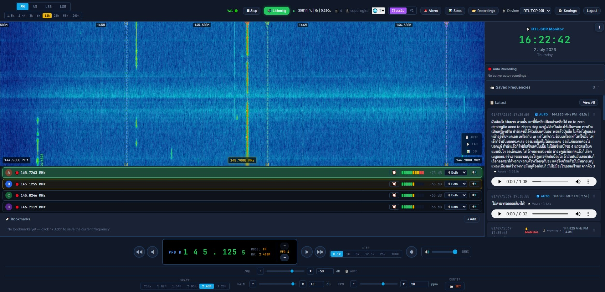
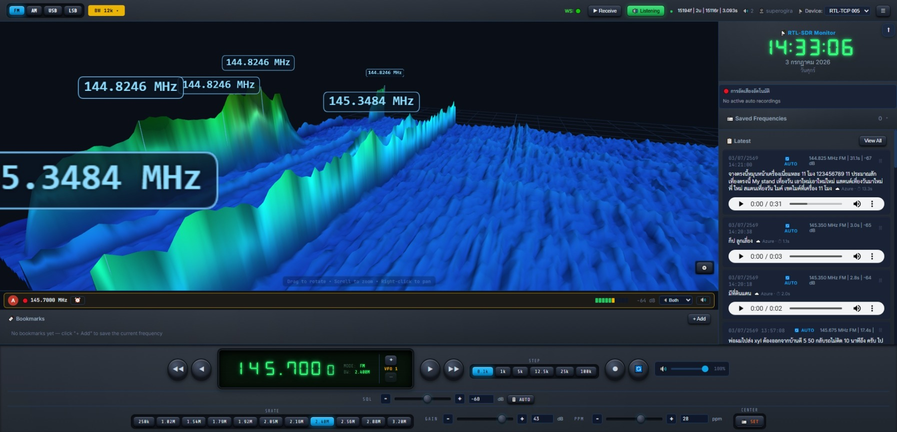
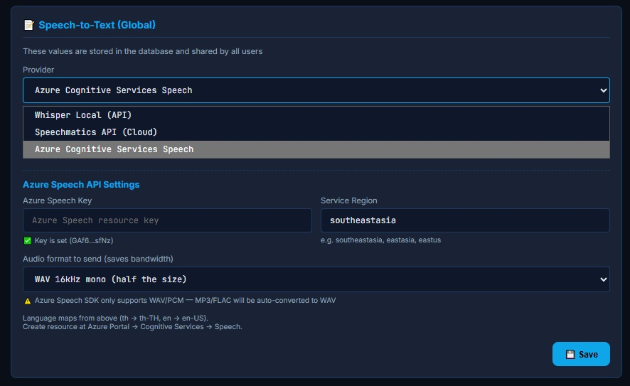
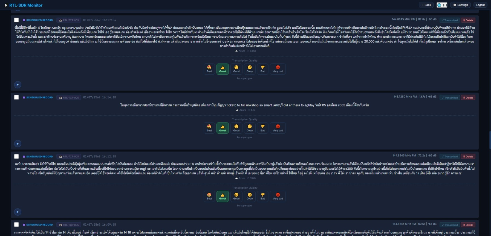
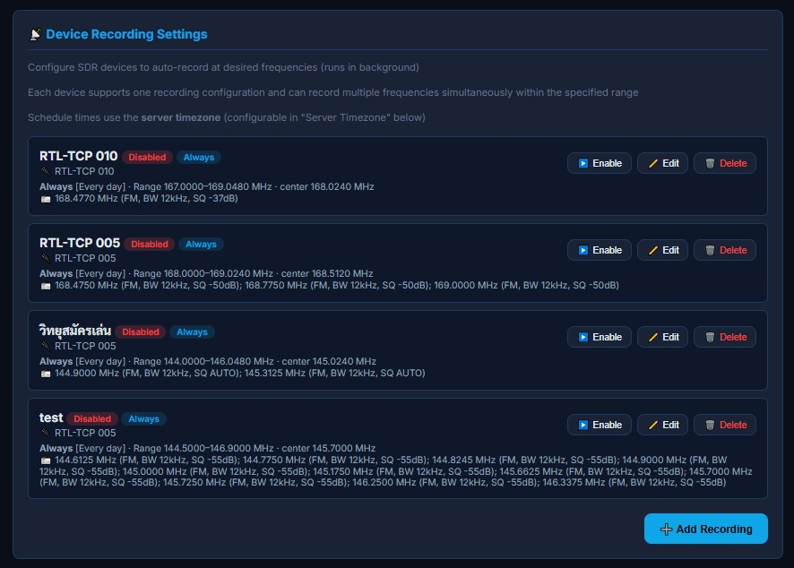
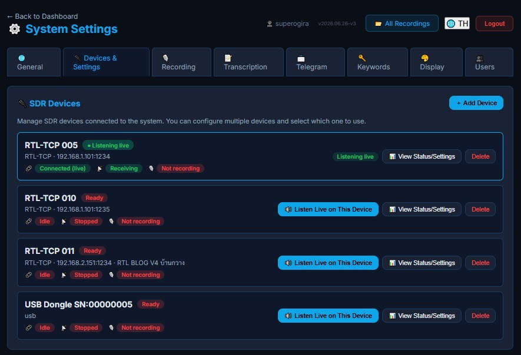
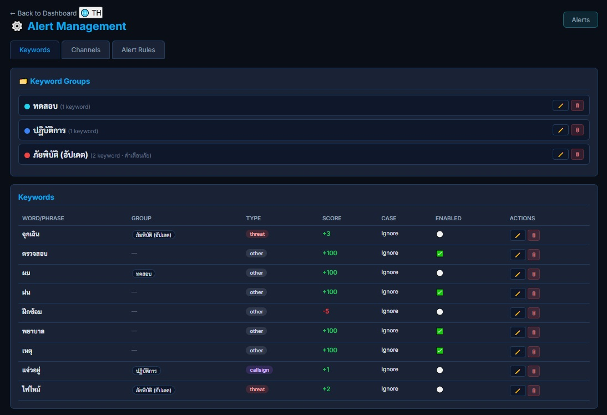
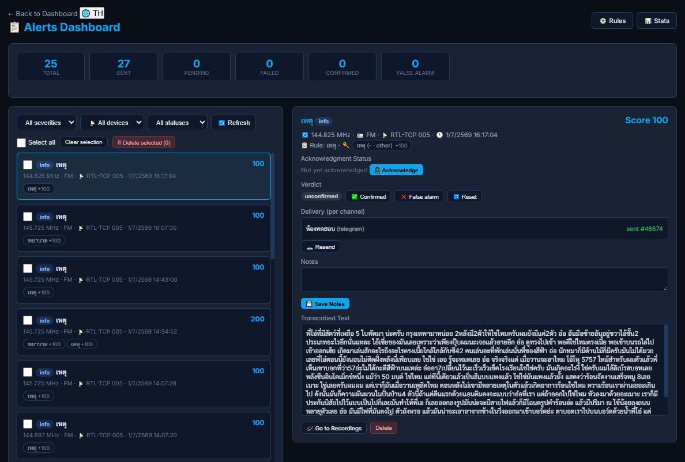
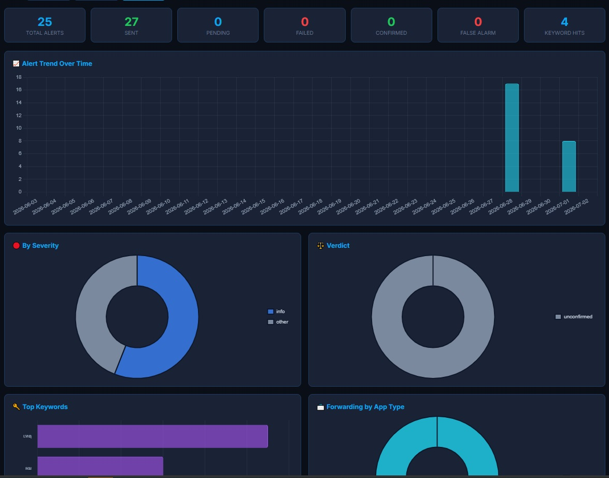

<div align="center">

# 📡 RTL-SDR Web Monitor

**Real-time Software-Defined Radio monitoring system with web-based waterfall, multi-user live audio, speech-to-text, and scheduled recordings.**

[English](#english) · [ภาษาไทย](#ภาษาไทย)

</div>

---

<a id="english"></a>

# RTL-SDR Web Monitor (English)

A self-hosted web-based RTL-SDR receiver, recorder, and intelligent monitoring platform. Listen to live radio in your browser, schedule background recordings, auto-transcribe audio to text with Whisper, and get instant Telegram alerts when your keywords are detected — all from a clean, bilingual (Thai/English) web UI.

Built for shared-tuner, multi-user environments: one RTL-SDR dongle serves many listeners, each with their own VFO offset, bookmarks.

## 🌐 Live Demo

Try it live at **[https://sdr.e25wop.com](https://sdr.e25wop.com)**

| Field | Value |
|-------|-------|
| URL | https://sdr.e25wop.com |
| Username | `demo_user` |
| Password | `demo1234` |

> ⚠️ The demo account is read-only (regular user). Some admin features (device settings, recording config, user management) are hidden.

## 📸 Screenshots

<div align="center">

| Dashboard (Waterfall + Controls) | 3D Waterfall |
|:---:|:---:|
|  |  |

| STT Settings  | Recordings + Transcription |
|:---:|:---:|
|  |  |

| Devices Settings | Schedule Recordings |
|:---:|:---:|
|  |  |

| Keyword & Alert Rules Editor | Alert Management |
|:---:|:---:|
|  |  |

| Alert Statistics |
|:---:|
|   |

</div>

---

## ✨ Features

### 📻 Core SDR
- **Shared tuner architecture** — one RTL-SDR device serves multiple simultaneous listeners via WebSocket audio fan-out
- **Real-time audio streaming** — over WebSocket with server-side demodulation
- **Multi-Mode Demodulation** — FM (NBFM/WBFM), AM, USB, LSB
- **RTL-TCP Support** — Connect to any `rtl_tcp` server on your network (dongle not required on the server machine)
- **Multi-Device Registry** — Manage multiple RTL-TCP devices, switch active device on-the-fly
- **Web-based Waterfall** — Real-time spectrum display with configurable FFT, 2D waterfall, and 3D waterfall (Three.js)

### 🎧 Multi-Listener Audio
- **Independent VFO per listener** — Each user can listen to a different frequency within the passband
- **Up to 4 VFOs per user (A–D)** — Listen to several frequencies at once, each routed to the left / right / both speakers
- **Per-Listener Squelch** — Auto (adaptive) or manual squelch with hysteresis, a 200 ms hang time (bridges word gaps) and 5 ms fade ramps (no clicks). The gate opens within ~50 ms so the first syllable is never clipped, and AUTO squelch tracks the noise floor without cutting off long transmissions. The threshold in force is shown next to each VFO's signal bars
- **Per-mode channel bandwidth** — FM: 6k/12k/25k/50k/200k · AM: 3k/6k/12k · SSB: 1.8k/2.4k/3k. The selection is applied per listener and reaches the DSP on every (re)connect
- **Solo / Priority Mode** — Long-press mute button to set a listener as SOLO (only that VFO) or PRIORITY (dims others)
- **G.711 µ-law Audio** — Efficient bandwidth usage for live streaming

### 🎙️ Recording & Scheduling
- **Auto Recording** — Voice-activated (squelch-gated) recordings
- **Manual recording** — Per-listener manual record button
- **Scheduled recording jobs** — Always-on or time-scheduled background recording with multi-frequency support
- **In-Browser Playback** — Listen to recordings directly, with transcript viewing
- **Retention Policies** — Auto-delete old recordings by count, age, or total duration (keep transcript option)
- **Auto Speech-to-Text** — every recording can be automatically transcribed on completion

### 🤖 Speech-to-Text (STT)
- **Speechmatics** — Cloud-based high-quality transcription
- **Azure Cognitive Services** — Microsoft cloud STT
- **Groq Whisper** — OpenAI-compatible cloud transcription
- **MaxPlus AI** — OpenAI-compatible cloud transcription ([api.maxplus-ai.cc](https://maxplus-ai.cc/docs/api)); live model catalog (`whisper-large-v3`, `grok-stt`, …) fetched via `GET /v1/models`
- **Whisper Local** — Self-hosted faster-whisper-server
- **Auto-Transcribe** — Automatically transcribe new recordings
- **Audio Preprocessing** — Optionally downsample/compress audio before STT to save bandwidth

### 🔔 Keyword Alerting & Notifications
- **Rule-based alert engine** — define rules with keyword matching, keyword groups and time-window schedules, active/inactive toggles
- **Telegram notifications** — delivered to configured chat/channel IDs, send alerts to Telegram channels/groups with transcription and audio link
- **Background worker** — polls a database-backed job queue every 2 seconds, evaluates rules against transcripts, and dispatches notifications
- **Alert history & statistics** — triage events, resend, test channels, and view analytics

### 🔐 Authentication & Users
- **JWT authentication** - with access and refresh tokens
- **Role-based access** — `admin` and `user` roles (admin-only settings & recording controls)
- **Per-user timezone** - for correct local-time display
- **CLI user management** — create superusers and regular users from the terminal

### 🔖 Bookmarks
- **Personal Bookmarks** — Save frequencies with name, mode per user (stored in the browser, per account)
- **Quick Navigation** — Click a bookmark to instantly tune to that frequency
- **Activity indicator** — A bookmark chip/row flashes when a signal above SQL is present on its frequency
- **Named Signal TAG** — When **📡 TAG** is on, strong signals on the waterfall are labelled with their frequency; if a bookmark matches, its name is appended (e.g. `168.4700 · Police Radio`)

### 🖥️ Dashboard
- **Real-time Clock** — Live frequency display with 7-segment style
- **Signal Meter (S-Meter)** — Real-time signal strength indicator
- **Spectrum + Waterfall** — 2D spectrum with configurable overlap
- **3D Waterfall** — Three.js-powered 3D spectrum visualization
- **Signal TAG** — Vertical frequency labels on signals stronger than SQL (with bookmark names)
- **Active Recordings** — Live status of all manual/auto/scheduled recordings
- **Status Bar** — Connection status, SDR status, listener count
- **Build versions** — The **⋮ More** menu shows the App / Audio / Prefs versions the browser loaded (handy to spot a stale cache after a deploy)

### ⚙️ Settings & Configuration
- **Web-based Settings UI** — Tabs for General, Display (Waterfall), SDR, Recording, STT, Telegram, Keywords, Users
- **VFO Passband Margin** — How far a VFO may tune from the center: `max_offset = min(sample_rate × ratio, sample_rate/2 − channel_bw/2)` (ratio 0.40–0.49). The second term keeps wide channels below Nyquist. The same limit is used by the backend, the dashboard warning and recording jobs; a click past the edge moves the VFO to the edge and shows a notice
- **Max Listeners Cap** — Limit concurrent listeners
- **Server Timezone** — Configurable timezone for job scheduler
- **Waterfall Display** — Configurable dB range, colors, FFT size

### 🌍 Internationalization
- **Bilingual UI** — Thai (default) and English, toggleable in the header

---

### 🏗 Architecture

```
┌──────────────┐    TCP:1234  ┌──────────────┐   HTTP/WS:8000   ┌────────────┐
│  USB RTL-SDR │ ◄──────────► │   rtl_tcp    │ ◄──────────────► │   Browser  │
│  (Hardware)  │   raw IQ     │   (Server)   │   spectrum/audio │  (Frontend)│
└──────────────┘              └──────┬───────┘                  └────────────┘
                                      │ TCP:1234
                                      ▼
                               ┌──────────────┐         ┌──────────────┐
                               │  FastAPI     │ ◄─────► │   SQLite     │
                               │  (Backend)   │         │  rtl_sdr.db  │
                               │  uvicorn:8000│         └──────────────┘
                               └──────────────┘
```

### Tech Stack
| Component | Technology |
|-----------|-----------|
| **Backend** | Python 3.11+, FastAPI, Uvicorn |
| **Database** | SQLite + aiosqlite (SQLAlchemy async) |
| **Signal Processing** | NumPy, SciPy |
| **Auth** | JWT (python-jose) + bcrypt |
| **STT** | faster-whisper (local) / Azure / Speechmatics |
| **Frontend** | Vanilla JS, HTML5, CSS3 |
| **Spectrum/Waterfall** | Canvas 2D + Three.js 3D |
| **Audio Streaming** | WebSocket (G.711 µ-law AUD2 frames) |
| **SDR interface** | rtl_tcp client (network) |
| **Deployment** | Docker / Docker Compose |

---

## 📋 Prerequisites

- **RTL-SDR dongle** (RTL2832U-based) and the `rtl-sdr` driver/toolkit installed
- A running **`rtl_tcp`** server your backend can reach (local or remote)

### Backend Server (No USB required)
- Python 3.11+
- pip, venv
- Build packages: `gcc`, `libffi-dev`

```bash
# Ubuntu/Debian
sudo apt update
sudo apt install -y python3.11 python3.11-venv python3-pip gcc libffi-dev
```

### RTL-SDR Dongle Machine (rtl_tcp host)
- `librtlsdr`
- `rtl_tcp` program
- USB RTL-SDR dongle (RTL2832U based)

```bash
sudo apt install -y rtl-sdr librtlsdr-dev

# Blacklist kernel drivers that conflict
sudo tee /etc/modprobe.d/blacklist-rtl.conf <<'EOF'
blacklist dvb_usb_rtl28xxu
blacklist rtl2832
blacklist rtl2830
EOF

sudo modprobe -r dvb_usb_rtl28xxu 2>/dev/null

# Test
rtl_test -t
```

---

## 🚀 Installation

### Option 1: Manual Installation

```bash
# 1. Clone the repository
git clone https://github.com/superogira/rtl-sdr-web.git
cd rtl-sdr-web

# 2. Create virtual environment and install dependencies
python3.11 -m venv venv
./venv/bin/pip install --upgrade pip
./venv/bin/pip install -r requirements.txt

# 3. Configure environment
cp .env.example .env
# Edit .env with your settings (at minimum: JWT_SECRET_KEY, RTL_TCP_HOST/PORT)

# 4. Create data directories
mkdir -p data data/recordings

# 5. Create admin user
./venv/bin/python3 -m backend.cli createsuperuser

# 6. Start the server
./venv/bin/uvicorn backend.main:app --host 0.0.0.0 --port 8000 --log-level info
```

### Option 2: Docker

```bash
# 1. Clone and configure
git clone https://github.com/superogira/rtl-sdr-web.git
cd rtl-sdr-web
cp .env.example .env
# Edit .env with your settings

# 2. Build and run
docker compose up -d
```

Open your browser at **http://localhost:8000**

---

## ⚙️ Configuration

All settings are controlled via environment variables (see `.env.example`). The database initializes automatically on startup; there is no manual migration step.

### Core

| Variable | Default | Description |
|----------|---------|-------------|
| `DATABASE_URL` | `sqlite+aiosqlite:///./data/rtl_sdr.db` | Database connection string |
| `SERVER_HOST` | `0.0.0.0` | Bind host |
| `SERVER_PORT` | `8000` | Bind port |
| `JWT_SECRET_KEY` | _(required)_ | Secret used to sign JWT tokens — **set this to a strong random value** |
| `JWT_ALGORITHM` | `HS256` | JWT signing algorithm |
| `JWT_ACCESS_TOKEN_EXPIRE_MINUTES` | `60` | Access token lifetime |
| `JWT_REFRESH_TOKEN_EXPIRE_DAYS` | `7` | Refresh token lifetime |

### SDR / rtl_tcp

| Variable | Default | Description |
|----------|---------|-------------|
| `RTL_TCP_HOST` | `127.0.0.1` | Host of the `rtl_tcp` server |
| `RTL_TCP_PORT` | `1234` | Port of the `rtl_tcp` server |
| `RTL_TCP_SAMPLE_RATE` | `2048000` | Sample rate (2.048 MSPS) |
| `RTL_TCP_CENTER_FREQ` | `145500000` | Initial frequency (145.5 MHz) |
| `RTL_TCP_GAIN` | `30` | Tuner gain (dB) |
| `AUTO_START_STREAMING` | `true` | Auto-connect on startup |
> Device index, gain, PPM correction, antenna, and sample rate are configured at runtime via the web UI / API.

### Speech-to-Text

| Variable | Description |
|----------|-------------|
| `STT_PROVIDER` | STT provider: speechmatics / azure / whisper_local / groq / maxplus |
| `WHISPER_LOCAL_HOST` | Host of a local Whisper STT service (if used) |
| `WHISPER_LOCAL_PORT` | Port of a local Whisper STT service |
| `WHISPER_LOCAL_MODEL` | Whisper model size (e.g. `base`, `small`, `medium`, `large-v3`) |
| `AZURE_SPEECH_KEY` | Azure Speech resource key (if using Azure) |
| `SPEECHMATICS_API_KEY` | Speechmatics API key (if using Speechmatics) |
| `GROQ_API_KEY` | Groq API key (if using Groq Whisper) |
| `GROQ_STT_MODEL` | Groq transcription model (e.g. `whisper-large-v3`) |
| `MAXPLUS_API_KEY` | MaxPlus AI API key, format `ccsk-…` (if using MaxPlus AI) |
| `MAXPLUS_STT_MODEL` | MaxPlus AI transcription model (e.g. `whisper-large-v3`, `grok-stt`) |

### Telegram Notifications

| Variable | Description |
|----------|-------------|
| `TELEGRAM_BOT_TOKEN` | Bot token from [@BotFather](https://t.me/BotFather) |
| `TELEGRAM_ENABLED` | Enable/disable Telegram delivery (`true`/`false`) |

## 👤 First-run: Create an Admin User

There is no default account. Create your first admin from the CLI:

```bash
# Interactive
python -m backend.cli createsuperuser

# Non-interactive
python -m backend.cli createuser <username> <password> admin
```

Then log in at the web UI with those credentials.

### Other CLI commands

| Command | Description |
|---------|-------------|
| `python -m backend.cli createsuperuser` | Create an admin user (interactive) |
| `python -m backend.cli createuser <username> <password> [admin]` | Create a user |
| `python -m backend.cli resetpassword <username>` | Reset a user's password |
| `python -m backend.cli migrate-db` | Run database migrations manually |

## 🧭 Web UI Pages

| Route | Description |
|-------|-------------|
| `/login` | Login screen |
| `/dashboard` | Live reception console — frequency, mode, waterfall, audio, VFO, recording |
| `/recordings` | Browse, play, and read transcripts of past recordings |
| `/alert-rules` | Configure keyword rules, keyword groups, and Telegram channels |
| `/alerts` | Alert event history and triage |
| `/stats` | Alert analytics and charts |
| `/settings` | Admin settings (SDR, Recording, STT, Telegram, Keywords, Users tabs) |
| `/admin/users` | User management |

## 📡 API Highlights

- `GET /api/health` — health check
- `GET /api/sdr/status` — tuner state (includes `vfo_margin_ratio` and `vfo_max_offset_hz`, the effective tuning limit)
- `GET /api/sdr/capabilities` — supported sample rates / gains for the active device
- `POST /api/sdr/connect|disconnect|connection` — connect/disconnect tuner, set rtl_tcp host/port
- `POST /api/sdr/frequency|sample-rate|gain|freq-correction` — hardware tuner control (admin)
- `POST /api/sdr/mode|bandwidth|squelch` — **global** defaults for the center channel and new listeners (admin). While listening live each user changes their own mode/BW/SQL over `WS /ws/audio`
- `POST /api/sdr/vfo` — move the VFO (clamped to the passband; the response reports `clamped` and `max_offset_hz`)
- `POST /api/sdr/vfo-margin` — set the VFO passband margin ratio 0.40–0.49 (admin)
- `POST /api/sdr/fft-size` — waterfall FFT size
- `POST /api/sdr/stream/start|stop` — start/stop the IQ stream
- `POST /api/sdr/record/start|stop` — manual recording of the center channel
- `GET|POST /api/sdr/recording-config`, `/api/sdr/recording-enabled` — recording policy (admin)
- `GET|PUT /api/sdr/max-listeners` — concurrent listener cap (admin)
- `/api/sdr/devices*` — SDR device registry (admin)
- `WS /ws` — control channel (status + spectrum)
- `WS /ws/audio` — per-listener live audio. Control messages: `vfo`, `mode`, `bandwidth`, `squelch`, `auto_squelch`, `record_start|stop`, `auto_record`; acks include `vfo_ack` (with `clamped`), `mode_ack`, `bandwidth_ack`, `squelch_ack` and `sig` frames (`db`, `sq_open`, `thr`, `auto`)
- `/api/recordings*` — recordings CRUD + transcripts
- `/api/recording-jobs*` — scheduled recording jobs
- `/api/settings/stt*` — STT provider settings (admin)
- `/api/alert-rules*`, `/api/alerts*`, `/api/alert-stats*` — alerting
- `/api/keyword-groups*`, `/api/keywords*`, `/api/channels*`, `/api/notification-groups*` — alert configuration
- `/api/auth/login|register|refresh|me|change-password`, `/api/auth/users*` — authentication & user management
- `GET /api/audio/stats|diag` — live audio diagnostics

## 🗂 Project Structure

```
.
├── backend/
│   ├── main.py              # FastAPI app, lifespan, WebSocket endpoints
│   ├── config.py            # Settings (env vars)
│   ├── database.py          # DB init + migrations
│   ├── cli.py               # User management CLI
│   ├── sdr/                 # Tuner control, rtl_tcp client, capture, job scheduler,
│   │                        #   vfo_limit.py (single VFO passband-limit formula)
│   ├── audio/               # Demodulation (FM/AM/USB/LSB), squelch, conversion, broadcaster
│   ├── alerts/              # Rule engine, worker, providers, router
│   ├── auth/                # JWT, dependencies, router
│   ├── models/              # SQLAlchemy models
│   ├── services/            # STT, Telegram, recording jobs, app settings
│   ├── migrations/versions/ # Alembic-style migrations
│   └── tests/               # unittest suite (DSP, squelch, bandwidth, VFO limit, rtl_tcp)
├── frontend/
│   ├── index.html
│   ├── pages/               # dashboard, recordings, alerts, settings, ...
│   ├── css/  js/  assets/
├── docs/
│   ├── WHISPER_LOCAL_STT.md
│   └── USB_RTL_SDR_SETUP.md
├── scripts/
│   └── reset_stuck_alerts.py
├── docker-compose.yml
├── Dockerfile
├── requirements.txt
└── .env.example
```

---
### CLI Tools

```bash
# Create admin user (interactive)
./venv/bin/python3 -m backend.cli createsuperuser

# Create user (non-interactive)
./venv/bin/python3 -m backend.cli createuser <username> <password> [admin]

# Reset password
./venv/bin/python3 -m backend.cli resetpassword <username>
```
---

## 🖥️ Usage

### First Login
1. Open **http://localhost:8000** in your browser
2. Log in with the admin credentials created.
3. You'll see the **Dashboard** with waterfall display

### Dashboard Controls
- **Mode Buttons** — FM / AM / USB / LSB
- **Bandwidth Buttons** — only the choices that make sense for the current mode are shown (FM 6k–200k, AM 3k/6k/12k, SSB 1.8k/2.4k/3k); switching mode picks that mode's default when needed
- **Frequency Control** — Click the waterfall to set the active VFO (a click past the usable passband edge moves the VFO to the edge and shows a notice); the CENTER button (admin) sets the hardware center frequency
- **SQL slider + 🎚️ AUTO** — Manual or adaptive squelch for your own listener; the threshold in force is shown next to the VFO signal bars (`SQL -83` / `AUTO -83`)
- **Gain / PPM Sliders** — Adjust tuner parameters (admin)
- **Listen Button** — Toggle live audio
- **Record Button** — Manual recording per VFO (long-press: auto-record)
- **📡 TAG** — Label strong signals on the waterfall with their frequency (+ bookmark name)
- **3D Toggle** — Switch between 2D and 3D waterfall views
- **⋮ More** — Language, theme, navigation and the loaded App / Audio / Prefs versions. After a deploy, press **Ctrl+F5** once if the versions look old

### Recordings Page
- View all recordings with filters (frequency, mode, date, source)
- Play audio in-browser
- View STT transcripts with quality ratings
- Delete individual recordings

### Settings Page
- **General** — User timezone, system policy (VFO Passband Margin, Max Listeners)
- **Devices & Settings** — rtl_tcp / USB device registry, connection, per-device defaults
- **Recording** — Auto-record, squelch, retention policies
- **Transcription** — STT provider selection, API keys, language, audio format
- **Telegram** — Bot token, chat ID
- **Keywords** — Alert keywords management
- **Display** — Waterfall dB range, FFT size, colors
- **Users** — User management (admin only)

### Recording Jobs
Admin users can set up scheduled recording jobs:
- **Always-on** — Continuous recording of specified frequencies
- **Scheduled** — Time-window based recording with day-of-week rules
- Each job supports multiple frequencies within a passband (frequencies outside the usable passband — same VFO margin rule as live listening — are flagged in the editor)
- Per-frequency manual or AUTO squelch
- Jobs run independently from live listening

### Running the Tests
```bash
./venv/bin/python -m unittest discover -s backend/tests -q
```
No SDR hardware is needed — the DSP, squelch, bandwidth and VFO-limit tests use synthetic IQ.

---

## 📖 Additional Documentation

- [`OPERATIONS.md`](./OPERATIONS.md) — Full operations guide (install, start/stop, migration, troubleshooting)
- [`HOW_TO_RESTART.md`](./HOW_TO_RESTART.md) — Quick restart reference
- [`docs/WHISPER_LOCAL_STT.md`](./docs/WHISPER_LOCAL_STT.md) — Setup guide for local Whisper STT
- [`docs/USB_RTL_SDR_SETUP.md`](./docs/USB_RTL_SDR_SETUP.md) — Using a USB RTL-SDR directly (no rtl_tcp)

---

## 🔧 Troubleshooting

| Problem | Solution |
|---------|----------|
| Can't connect to RTL-TCP | Check `rtl_tcp` is running: `ss -tlnp \| grep 1234` |
| No audio / waterfall | Ensure `AUTO_START_STREAMING=true` or click Connect + Stream |
| Audio stuttering | Check network latency to rtl_tcp; reduce sample rate |
| STT not working | Verify API keys in Settings → Transcription |
| SQLite errors | Check `data/` directory is writable |
| "Out of receive range" near the waterfall edge | The VFO is past the passband limit (`min(sample_rate × ratio, sample_rate/2 − BW/2)`). Raise the ratio in Settings → General (max 0.49), narrow the BW, or move the center frequency |
| UI behaves like an old version after an update | Open **⋮ More** and check the App / Audio / Prefs versions; press **Ctrl+F5** to reload cached files |

## 🤝 Contributing

Contributions are welcome! Please feel free to submit a Pull Request.

---

## 📄 License

This project is open source. Released under the **MIT License**. See [LICENSE](LICENSE).

---
<div align="center">

**Made with ❤️ for the radio enthusiast community**

</div>

<div align="center">

# 📡 RTL-SDR Web Monitor

**ระบบตรวจสอบ Software-Defined Radio (SDR) แบบเรียลไทม์ พร้อมการแสดงผลสเปกตรัม (waterfall) บนเว็บ, ระบบฟังเสียงสดสำหรับผู้ใช้หลายคน, ระบบแปลงเสียงเป็นข้อความ (STT) และการตั้งเวลาบันทึกเสียง**

[English](#english) · [ภาษาไทย](#ภาษาไทย)

</div>

---

<a id="ภาษาไทย"></a>

# RTL-SDR Web Monitor (ภาษาไทย)

แพลตฟอร์มสำหรับรับสัญญาณ บันทึกเสียง และตรวจสอบ RTL-SDR อัจฉริยะผ่านเว็บแบบ self-hosted คุณสามารถฟังวิทยุสดผ่านเบราว์เซอร์, ตั้งเวลาบันทึกเสียงเบื้องหลัง, แปลงเสียงเป็นข้อความอัตโนมัติด้วย Whisper, และรับการแจ้งเตือนทันทีผ่าน Telegram เมื่อพบคำค้นหา (keywords) ที่ตั้งไว้ — ทั้งหมดนี้ทำงานบน Web UI ที่สะอาดตาและรองรับสองภาษา (ไทย/อังกฤษ)

ออกแบบมาสำหรับสภาพแวดล้อมที่มีผู้ใช้หลายคนและใช้จูนเนอร์ร่วมกัน: RTL-SDR dongle เพียงตัวเดียวสามารถให้บริการผู้ฟังได้หลายคนพร้อมกัน โดยแต่ละคนสามารถตั้งค่า VFO (ความถี่) และบุ๊กมาร์กของตัวเองได้อย่างอิสระ

## ✨ คุณสมบัติ

### 📻 ระบบ SDR หลัก

* **สถาปัตยกรรมจูนเนอร์แบบแบ่งปัน** — อุปกรณ์ RTL-SDR หนึ่งตัวให้บริการผู้ฟังหลายคนพร้อมกันผ่านการกระจายเสียงด้วย WebSocket
* **สตรีมเสียงแบบเรียลไทม์** — ผ่าน WebSocket พร้อมการถอดรหัสสัญญาณ (demodulation) ที่ฝั่งเซิร์ฟเวอร์
* **รองรับการถอดรหัสหลายโหมด** — FM (NBFM/WBFM), AM, USB, LSB
* **รองรับ RTL-TCP** — เชื่อมต่อกับเซิร์ฟเวอร์ `rtl_tcp` ในเครือข่ายของคุณ (ไม่จำเป็นต้องเสียบ dongle ที่เครื่องเซิร์ฟเวอร์หลัก)
* **ระบบจัดการหลายอุปกรณ์** — จัดการอุปกรณ์ RTL-TCP ได้หลายตัว และสามารถสลับใช้งานอุปกรณ์ได้ทันที
* **Waterfall บนเว็บ** — แสดงผลสเปกตรัมแบบเรียลไทม์ สามารถปรับแต่งค่า FFT ได้, มีทั้ง Waterfall แบบ 2D และแบบ 3D (ใช้ Three.js)

### 🎧 ระบบเสียงสำหรับผู้ฟังหลายคน

* **VFO อิสระสำหรับผู้ใช้แต่ละคน** — ผู้ใช้แต่ละคนสามารถเลือกฟังความถี่ที่แตกต่างกันได้ภายในย่านความถี่ (passband) ที่รับได้
* **สูงสุด 4 VFO ต่อผู้ใช้ (A–D)** — ฟังหลายความถี่พร้อมกัน แต่ละ VFO เลือกลำโพงซ้าย / ขวา / ทั้งคู่ได้
* **Squelch แยกตามผู้ฟัง** — ระบบตัดเสียงรบกวน (Squelch) แบบอัตโนมัติ (ปรับตามสภาพ) หรือแบบกำหนดเอง พร้อม hysteresis, hang time 200 ms (ไม่ขาดตอนระหว่างช่วงเว้นคำ) และ fade 5 ms (ไม่มีเสียงคลิก) เปิดประตูเสียงภายใน ~50 ms คำแรกจึงไม่หาย และ AUTO squelch ไม่ตัดการส่งที่ยาว ค่า threshold ที่ใช้จริงแสดงข้างแถบสัญญาณของแต่ละ VFO
* **เลือก Bandwidth ตามโหมด** — FM: 6k/12k/25k/50k/200k · AM: 3k/6k/12k · SSB: 1.8k/2.4k/3k โดยค่าที่เลือกมีผลกับ DSP ของผู้ฟังแต่ละคน และถูกส่งไปทุกครั้งที่เชื่อมต่อใหม่
* **โหมดเดี่ยว (Solo) / โหมดให้ความสำคัญ (Priority)** — กดปุ่มปิดเสียงค้างไว้เพื่อตั้งให้ผู้ฟังเป็นแบบ SOLO (ฟังเฉพาะ VFO นั้น) หรือ PRIORITY (หรี่เสียง VFO อื่นลง)
* **เสียงรูปแบบ G.711 µ-law** — ใช้แบนด์วิดท์อย่างมีประสิทธิภาพสำหรับการสตรีมสด

### 🎙️ การบันทึกเสียงและการตั้งเวลา

* **บันทึกเสียงอัตโนมัติ** — ทำงานเมื่อมีเสียงเข้า (ควบคุมด้วย squelch)
* **บันทึกเสียงด้วยตนเอง** — มีปุ่มบันทึกเสียงแบบแมนนวลสำหรับผู้ใช้แต่ละคน
* **ตั้งเวลาบันทึกเสียง (Scheduled jobs)** — บันทึกเสียงเบื้องหลังแบบทำงานตลอดเวลาหรือตามเวลาที่กำหนด รองรับการบันทึกหลายความถี่พร้อมกัน
* **ฟังเสียงผ่านเบราว์เซอร์** — ฟังไฟล์ที่บันทึกไว้ได้โดยตรง พร้อมดูข้อความที่ถอดเสียงได้ทันที
* **นโยบายการเก็บรักษาข้อมูล** — ลบไฟล์บันทึกเก่าอัตโนมัติตามจำนวนไฟล์, อายุไฟล์, หรือระยะเวลารวม (มีตัวเลือกให้เก็บเฉพาะข้อความไว้ได้)
* **แปลงเสียงเป็นข้อความอัตโนมัติ (Auto STT)** — ทุกการบันทึกสามารถตั้งให้ถอดเสียงเป็นข้อความได้อัตโนมัติเมื่อบันทึกเสร็จ

### 🤖 ระบบแปลงเสียงเป็นข้อความ (STT)

* **Speechmatics** — บริการถอดเสียงคุณภาพสูงบนคลาวด์
* **Azure Cognitive Services** — บริการ STT บนคลาวด์ของ Microsoft
* **Groq Whisper** — บริการถอดเสียงบนคลาวด์ แบบ OpenAI-compatible
* **MaxPlus AI** — บริการถอดเสียงบนคลาวด์แบบ OpenAI-compatible ([api.maxplus-ai.cc](https://maxplus-ai.cc/docs/api)) ดึงรายชื่อโมเดลสดจาก `GET /v1/models` (เช่น `whisper-large-v3`, `grok-stt`)
* **Whisper Local** — เซิร์ฟเวอร์ faster-whisper สำหรับโฮสต์ใช้งานเอง
* **ถอดเสียงอัตโนมัติ** — แปลงเสียงที่บันทึกใหม่เป็นข้อความโดยอัตโนมัติ
* **การประมวลผลเสียงล่วงหน้า** — มีตัวเลือกลดความละเอียด/บีบอัดเสียงก่อนส่งไปยัง STT เพื่อประหยัดแบนด์วิดท์

### 🔔 การแจ้งเตือนคีย์เวิร์ด

* **ระบบแจ้งเตือนตามกฎ (Rule-based engine)** — กำหนดกฎด้วยการจับคู่คำสำคัญ (keywords), กลุ่มคำสำคัญ, กำหนดช่วงเวลาทำงาน และเปิด/ปิดการทำงานได้
* **การแจ้งเตือนทาง Telegram** — ส่งไปยังแชท/ช่องที่กำหนดไว้ ส่งข้อความแจ้งเตือนพร้อมข้อความที่ถอดเสียงและลิงก์ไฟล์เสียง
* **Background worker** — ตรวจสอบคิวงานในฐานข้อมูลทุกๆ 2 วินาที ประเมินกฎเทียบกับข้อความที่ถอดได้ และส่งการแจ้งเตือน
* **ประวัติและสถิติการแจ้งเตือน** — ตรวจสอบเหตุการณ์, ส่งข้อความซ้ำ, ทดสอบช่องทางการส่ง และดูข้อมูลวิเคราะห์

### 🔐 การยืนยันตัวตนและผู้ใช้งาน

* **การยืนยันตัวตนด้วย JWT** - พร้อม access token และ refresh token
* **สิทธิ์การเข้าถึงแบบ Role-based** — บทบาท `admin` และ `user` (เฉพาะแอดมินที่เข้าถึงการตั้งค่าและการควบคุมการบันทึกได้)
* **เขตเวลา (Timezone) แยกตามผู้ใช้** - เพื่อการแสดงผลเวลาท้องถิ่นที่ถูกต้อง
* **การจัดการผู้ใช้ผ่าน CLI** — สร้างผู้ดูแลระบบ (superusers) และผู้ใช้ทั่วไปผ่านเทอร์มินัล

### 🔖 บุ๊กมาร์ก

* **บุ๊กมาร์กส่วนตัว** — บันทึกความถี่พร้อมชื่อและโหมดการรับฟัง (แยกตามผู้ใช้ เก็บในเบราว์เซอร์)
* **นำทางอย่างรวดเร็ว** — คลิกที่บุ๊กมาร์กเพื่อเปลี่ยนความถี่ไปยังจุดนั้นทันที
* **แสดงสถานะสัญญาณ** — ปุ่ม/แถวบุ๊กมาร์กกะพริบเมื่อมีสัญญาณแรงกว่า SQL ที่ความถี่นั้น
* **ชื่อบน Signal TAG** — เมื่อเปิด **📡 TAG** สัญญาณแรงบน waterfall จะแสดงความถี่ และถ้าตรงกับบุ๊กมาร์กจะต่อชื่อท้าย (เช่น `168.4700 · วิทยุตำรวจ`)

### 🖥️ แดชบอร์ด

* **นาฬิกาเรียลไทม์** — แสดงความถี่สดในรูปแบบตัวเลข 7-segment
* **Signal Meter (S-Meter)** — ตัวแสดงความแรงของสัญญาณแบบเรียลไทม์
* **สเปกตรัม + Waterfall** — สเปกตรัม 2D พร้อมระบบซ้อนทับที่ปรับตั้งค่าได้
* **3D Waterfall** — การแสดงผลสเปกตรัมแบบ 3D ขับเคลื่อนด้วย Three.js
* **Signal TAG** — ป้ายความถี่แนวตั้งบนสัญญาณที่แรงกว่า SQL (พร้อมชื่อบุ๊กมาร์ก)
* **สถานะการบันทึก** — แสดงสถานะสดของการบันทึกทั้งหมด (แมนนวล/อัตโนมัติ/ตั้งเวลา)
* **แถบสถานะ** — สถานะการเชื่อมต่อ, สถานะ SDR, จำนวนผู้ฟัง
* **เวอร์ชันไฟล์** — เมนู **⋮ More** แสดงเวอร์ชัน App / Audio / Prefs ที่เบราว์เซอร์โหลดอยู่ (ใช้ตรวจว่าติด cache เก่าหลัง deploy หรือไม่)

### ⚙️ การตั้งค่าและคอนฟิกูเรชัน

* **Web UI สำหรับการตั้งค่า** — แบ่งเป็นแท็บต่างๆ: ทั่วไป, การแสดงผล (Waterfall), SDR, การบันทึก, STT, Telegram, คีย์เวิร์ด, ผู้ใช้
* **VFO Passband Margin** — กำหนดว่า VFO จูนห่างจากความถี่กลางได้เท่าไร: `max_offset = min(sample_rate × ratio, sample_rate/2 − channel_bw/2)` (ratio 0.40–0.49) พจน์หลังกันไม่ให้ช่องกว้างล้นขอบ Nyquist ใช้ limit เดียวกันทั้ง backend, การเตือนบนแดชบอร์ด และงานบันทึกเสียง คลิกเลยขอบจะย้าย VFO ไปที่ขอบพร้อมแจ้งเตือน
* **จำกัดจำนวนผู้ฟังสูงสุด** — จำกัดจำนวนผู้ฟังที่เข้าใช้งานพร้อมกัน
* **เขตเวลาเซิร์ฟเวอร์ (Server Timezone)** — ตั้งค่าเขตเวลาสำหรับระบบตั้งเวลางาน
* **การแสดงผล Waterfall** — ปรับตั้งช่วงค่า dB, สี, และขนาด FFT

### 🌍 การรองรับหลายภาษา

* **UI สองภาษา** — ภาษาไทย (ค่าเริ่มต้น) และภาษาอังกฤษ สามารถสลับได้ที่ส่วนหัวของเว็บ

---

### 🏗 สถาปัตยกรรม

```
┌──────────────┐    TCP:1234  ┌──────────────┐   HTTP/WS:8000   ┌────────────┐
│  USB RTL-SDR │ ◄──────────► │    rtl_tcp     │ ◄──────────────► │   Browser  │
│  (Hardware)  │   raw IQ     │    (Server)    │   spectrum/audio │  (Frontend)│
└──────────────┘              └──────┬───────┘                  └────────────┘
                                     │ TCP:1234
                                     ▼
                               ┌──────────────┐         ┌──────────────┐
                               │  FastAPI     │ ◄─────► │    SQLite    │
                               │  (Backend)   │         │  rtl_sdr.db  │
                               │  uvicorn:8000│         └──────────────┘
                               └──────────────┘

```

### เทคโนโลยีที่ใช้ (Tech Stack)

| องค์ประกอบ | เทคโนโลยี |
| --- | --- |
| **Backend** | Python 3.11+, FastAPI, Uvicorn |
| **Database** | SQLite + aiosqlite (SQLAlchemy async) |
| **Signal Processing** | NumPy, SciPy |
| **Auth** | JWT (python-jose) + bcrypt |
| **STT** | faster-whisper (local) / Azure / Speechmatics |
| **Frontend** | Vanilla JS, HTML5, CSS3 |
| **Spectrum/Waterfall** | Canvas 2D + Three.js 3D |
| **Audio Streaming** | WebSocket (G.711 µ-law AUD2 frames) |
| **SDR interface** | rtl_tcp client (เครือข่าย) |
| **Deployment** | Docker / Docker Compose |

---

## 📋 ข้อกำหนดเบื้องต้น

* **RTL-SDR dongle** (ชิป RTL2832U) และติดตั้งไดรเวอร์/เครื่องมือ `rtl-sdr` แล้ว
* เซิร์ฟเวอร์ **`rtl_tcp`** ที่กำลังทำงานอยู่ และ backend ของคุณสามารถเชื่อมต่อได้ (เครื่องเดียวกันหรือผ่านเครือข่าย)

### เซิร์ฟเวอร์ Backend (ไม่จำเป็นต้องใช้ USB)

* Python 3.11+
* pip, venv
* แพ็กเกจสำหรับการคอมไพล์: `gcc`, `libffi-dev`

```bash
# Ubuntu/Debian
sudo apt update
sudo apt install -y python3.11 python3.11-venv python3-pip gcc libffi-dev

```

### เครื่องที่เสียบ RTL-SDR Dongle (โฮสต์ rtl_tcp)

* `librtlsdr`
* โปรแกรม `rtl_tcp`
* USB RTL-SDR dongle (ชิป RTL2832U)

```bash
sudo apt install -y rtl-sdr librtlsdr-dev

# บล็อก (Blacklist) ไดรเวอร์ของเคอร์เนลที่อาจขัดแย้งกัน
sudo tee /etc/modprobe.d/blacklist-rtl.conf <<'EOF'
blacklist dvb_usb_rtl28xxu
blacklist rtl2832
blacklist rtl2830
EOF

sudo modprobe -r dvb_usb_rtl28xxu 2>/dev/null

# ทดสอบการเชื่อมต่อ
rtl_test -t

```

---

## 🚀 การติดตั้ง

### ทางเลือกที่ 1: ติดตั้งด้วยตนเอง

```bash
# 1. โคลน repository
git clone https://github.com/superogira/rtl-sdr-web.git
cd rtl-sdr-web

# 2. สร้าง virtual environment และติดตั้งไลบรารี
python3.11 -m venv venv
./venv/bin/pip install --upgrade pip
./venv/bin/pip install -r requirements.txt

# 3. ตั้งค่า environment
cp .env.example .env
# แก้ไขไฟล์ .env ตามการตั้งค่าของคุณ (อย่างน้อยต้องตั้งค่า: JWT_SECRET_KEY, RTL_TCP_HOST/PORT)

# 4. สร้างโฟลเดอร์สำหรับเก็บข้อมูล
mkdir -p data data/recordings

# 5. สร้างผู้ใช้งานระดับแอดมิน
./venv/bin/python3 -m backend.cli createsuperuser

# 6. เริ่มการทำงานของเซิร์ฟเวอร์
./venv/bin/uvicorn backend.main:app --host 0.0.0.0 --port 8000 --log-level info

```

### ทางเลือกที่ 2: ใช้ Docker

```bash
# 1. โคลนและตั้งค่า
git clone https://github.com/superogira/rtl-sdr-web.git
cd rtl-sdr-web
cp .env.example .env
# แก้ไขไฟล์ .env ตามการตั้งค่าของคุณ

# 2. Build และรันโปรแกรม
docker compose up -d

```

เปิดเบราว์เซอร์แล้วไปที่ **http://localhost:8000**

---

## ⚙️ การตั้งค่า

การตั้งค่าทั้งหมดถูกควบคุมผ่านตัวแปรสภาพแวดล้อม (ดูที่ `.env.example`) ฐานข้อมูลจะถูกสร้างขึ้นอัตโนมัติเมื่อระบบเริ่มทำงาน ไม่จำเป็นต้องทำ migration ด้วยตนเอง

### การตั้งค่าหลัก (Core)

| ตัวแปร | ค่าเริ่มต้น | คำอธิบาย |
| --- | --- | --- |
| `DATABASE_URL` | `sqlite+aiosqlite:///./data/rtl_sdr.db` | สตริงเชื่อมต่อฐานข้อมูล |
| `SERVER_HOST` | `0.0.0.0` | Bind host |
| `SERVER_PORT` | `8000` | Bind port |
| `JWT_SECRET_KEY` | *(จำเป็น)* | รหัสลับที่ใช้เซ็นโทเค็น JWT — **โปรดตั้งค่านี้เป็นสุ่มที่คาดเดายาก** |
| `JWT_ALGORITHM` | `HS256` | อัลกอริทึมสำหรับเซ็น JWT |
| `JWT_ACCESS_TOKEN_EXPIRE_MINUTES` | `60` | ระยะเวลาหมดอายุของ Access token |
| `JWT_REFRESH_TOKEN_EXPIRE_DAYS` | `7` | ระยะเวลาหมดอายุของ Refresh token |

### SDR / rtl_tcp

| ตัวแปร | ค่าเริ่มต้น | คำอธิบาย |
| --- | --- | --- |
| `RTL_TCP_HOST` | `127.0.0.1` | โฮสต์ของเซิร์ฟเวอร์ `rtl_tcp` |
| `RTL_TCP_PORT` | `1234` | พอร์ตของเซิร์ฟเวอร์ `rtl_tcp` |
| `RTL_TCP_SAMPLE_RATE` | `2048000` | Sample rate (2.048 MSPS) |
| `RTL_TCP_CENTER_FREQ` | `145500000` | ความถี่เริ่มต้น (145.5 MHz) |
| `RTL_TCP_GAIN` | `30` | อัตราขยายของจูนเนอร์ (dB) |
| `AUTO_START_STREAMING` | `true` | เชื่อมต่ออัตโนมัติเมื่อระบบเริ่มทำงาน |

> ดัชนีอุปกรณ์ (Device index), อัตราขยาย, การแก้ไขค่า PPM, เสาอากาศ, และ sample rate สามารถปรับตั้งค่าขณะใช้งานผ่านทาง Web UI / API ได้

### ระบบแปลงเสียงเป็นข้อความ (Speech-to-Text)

| ตัวแปร | คำอธิบาย |
| --- | --- |
| `STT_PROVIDER` | ผู้ให้บริการ STT: speechmatics / azure / whisper_local / groq / maxplus |
| `WHISPER_LOCAL_HOST` | โฮสต์ของบริการ Whisper STT ภายใน (หากใช้งาน) |
| `WHISPER_LOCAL_PORT` | พอร์ตของบริการ Whisper STT ภายใน |
| `WHISPER_LOCAL_MODEL` | ขนาดโมเดลของ Whisper (เช่น `base`, `small`, `medium`, `large-v3`) |
| `AZURE_SPEECH_KEY` | คีย์ทรัพยากร Azure Speech (หากใช้ Azure) |
| `SPEECHMATICS_API_KEY` | คีย์ API ของ Speechmatics (หากใช้ Speechmatics) |
| `GROQ_API_KEY` | คีย์ API ของ Groq (หากใช้ Groq Whisper) |
| `GROQ_STT_MODEL` | โมเดลถอดเสียงของ Groq (เช่น `whisper-large-v3`) |
| `MAXPLUS_API_KEY` | คีย์ API ของ MaxPlus AI รูปแบบ `ccsk-…` (หากใช้ MaxPlus AI) |
| `MAXPLUS_STT_MODEL` | โมเดลถอดเสียงของ MaxPlus AI (เช่น `whisper-large-v3`, `grok-stt`) |

### การแจ้งเตือนผ่าน Telegram

| ตัวแปร | คำอธิบาย |
| --- | --- |
| `TELEGRAM_BOT_TOKEN` | โทเค็นบอทจาก [@BotFather](https://t.me/BotFather) |
| `TELEGRAM_ENABLED` | เปิด/ปิด การส่งข้อความผ่าน Telegram (`true`/`false`) |

## 👤 การใช้งานครั้งแรก: สร้างผู้ดูแลระบบ

ไม่มีบัญชีเริ่มต้นให้ คุณต้องสร้างแอดมินคนแรกผ่านทาง CLI:

```bash
# แบบโต้ตอบ (Interactive)
python -m backend.cli createsuperuser

# แบบไม่โต้ตอบ (Non-interactive)
python -m backend.cli createuser <username> <password> admin

```

จากนั้นให้เข้าสู่ระบบผ่าน Web UI ด้วยข้อมูลรับรองนั้น

### คำสั่ง CLI อื่นๆ

| คำสั่ง | คำอธิบาย |
| --- | --- |
| `python -m backend.cli createsuperuser` | สร้างผู้ดูแลระบบ (แบบโต้ตอบ) |
| `python -m backend.cli createuser <username> <password> [admin]` | สร้างผู้ใช้ทั่วไป |
| `python -m backend.cli resetpassword <username>` | รีเซ็ตรหัสผ่านของผู้ใช้ |
| `python -m backend.cli migrate-db` | รันการทำ database migrations ด้วยตัวเอง |

## 🧭 หน้า Web UI

| Route | คำอธิบาย |
| --- | --- |
| `/login` | หน้าเข้าสู่ระบบ |
| `/dashboard` | คอนโซลรับสัญญาณสด — ความถี่, โหมด, waterfall, เสียง, VFO, การบันทึก |
| `/recordings` | เรียกดู, ฟัง, และอ่านข้อความของไฟล์เสียงที่บันทึกไว้ในอดีต |
| `/alert-rules` | ตั้งค่ากฎคีย์เวิร์ด, กลุ่มคีย์เวิร์ด, และช่องทาง Telegram |
| `/alerts` | ประวัติเหตุการณ์แจ้งเตือน และการจัดการเบื้องต้น |
| `/stats` | สถิติและกราฟวิเคราะห์การแจ้งเตือน |
| `/settings` | การตั้งค่าสำหรับแอดมิน (แท็บ SDR, Recording, STT, Telegram, Keywords, Users) |
| `/admin/users` | ระบบจัดการผู้ใช้งาน |

## 📡 จุดเด่นของ API

* `GET /api/health` — ตรวจสอบสถานะระบบ
* `GET /api/sdr/status` — สถานะของจูนเนอร์ (มี `vfo_margin_ratio` และ `vfo_max_offset_hz` คือขอบการจูนที่ใช้จริง)
* `GET /api/sdr/capabilities` — sample rate / gain ที่อุปกรณ์รองรับ
* `POST /api/sdr/connect|disconnect|connection` — เชื่อมต่อ/ตัดการเชื่อมต่อจูนเนอร์, ตั้ง host/port ของ rtl_tcp
* `POST /api/sdr/frequency|sample-rate|gain|freq-correction` — ควบคุมฮาร์ดแวร์จูนเนอร์ (แอดมิน)
* `POST /api/sdr/mode|bandwidth|squelch` — ค่าเริ่มต้น **global** ของช่องกลางและผู้ฟังใหม่ (แอดมิน) ขณะฟังสดผู้ใช้แต่ละคนเปลี่ยน mode/BW/SQL ของตัวเองผ่าน `WS /ws/audio`
* `POST /api/sdr/vfo` — ย้าย VFO (บีบให้อยู่ใน passband คำตอบมี `clamped` และ `max_offset_hz`)
* `POST /api/sdr/vfo-margin` — ตั้ง VFO passband margin ratio 0.40–0.49 (แอดมิน)
* `POST /api/sdr/fft-size` — ขนาด FFT ของ waterfall
* `POST /api/sdr/stream/start|stop` — เริ่ม/หยุด สตรีม IQ
* `POST /api/sdr/record/start|stop` — บันทึกเสียงช่องกลางแบบแมนนวล
* `GET|POST /api/sdr/recording-config`, `/api/sdr/recording-enabled` — นโยบายการบันทึก (แอดมิน)
* `GET|PUT /api/sdr/max-listeners` — จำกัดจำนวนผู้ฟังพร้อมกัน (แอดมิน)
* `/api/sdr/devices*` — ระบบจัดการอุปกรณ์ SDR (แอดมิน)
* `WS /ws` — ช่องควบคุม (สถานะ + สเปกตรัม)
* `WS /ws/audio` — เสียงสดแยกตามผู้ฟัง คำสั่ง: `vfo`, `mode`, `bandwidth`, `squelch`, `auto_squelch`, `record_start|stop`, `auto_record` ตอบกลับด้วย `vfo_ack` (มี `clamped`), `mode_ack`, `bandwidth_ack`, `squelch_ack` และเฟรม `sig` (`db`, `sq_open`, `thr`, `auto`)
* `/api/recordings*` — การจัดการข้อมูลบันทึก (CRUD) + ข้อความ STT
* `/api/recording-jobs*` — งานตั้งเวลาบันทึกเสียง
* `/api/settings/stt*` — ตั้งค่าผู้ให้บริการ STT (แอดมิน)
* `/api/alert-rules*`, `/api/alerts*`, `/api/alert-stats*` — ระบบแจ้งเตือน
* `/api/keyword-groups*`, `/api/keywords*`, `/api/channels*`, `/api/notification-groups*` — การตั้งค่าแจ้งเตือน
* `/api/auth/login|register|refresh|me|change-password`, `/api/auth/users*` — ระบบยืนยันตัวตนและจัดการผู้ใช้
* `GET /api/audio/stats|diag` — ข้อมูลวินิจฉัยเสียงสด

## 🗂 โครงสร้างโปรเจกต์

```
.
├── backend/
│   ├── main.py              # แอป FastAPI, lifespan, รูท WebSocket
│   ├── config.py            # การตั้งค่า (ตัวแปร env)
│   ├── database.py          # ตั้งค่าฐานข้อมูล + migrations
│   ├── cli.py               # CLI จัดการผู้ใช้งาน
│   ├── sdr/                 # ควบคุมจูนเนอร์, rtl_tcp client, ดักจับข้อมูล, ระบบตั้งเวลางาน,
│   │                        #   vfo_limit.py (สูตรขอบ passband ของ VFO ชุดเดียว)
│   ├── audio/               # ถอดรหัสสัญญาณ (FM/AM/USB/LSB), squelch, แปลงข้อมูล, บรอดคาสเตอร์
│   ├── alerts/              # Rule engine, worker, providers, router
│   ├── auth/                # JWT, dependencies, router
│   ├── models/              # โมเดล SQLAlchemy
│   ├── services/            # STT, Telegram, งานบันทึกเสียง, การตั้งค่าแอป
│   ├── migrations/versions/ # Migrations สไตล์ Alembic
│   └── tests/               # ชุดทดสอบ unittest (DSP, squelch, bandwidth, VFO limit, rtl_tcp)
├── frontend/
│   ├── index.html
│   ├── pages/               # dashboard, recordings, alerts, settings, ...
│   ├── css/  js/  assets/
├── docs/
│   ├── WHISPER_LOCAL_STT.md
│   └── USB_RTL_SDR_SETUP.md
├── scripts/
│   └── reset_stuck_alerts.py
├── docker-compose.yml
├── Dockerfile
├── requirements.txt
└── .env.example

```

---

### เครื่องมือ CLI

```bash
# สร้างผู้ดูแลระบบ (แบบโต้ตอบ)
./venv/bin/python3 -m backend.cli createsuperuser

# สร้างผู้ใช้ทั่วไป (แบบไม่โต้ตอบ)
./venv/bin/python3 -m backend.cli createuser <username> <password> [admin]

# รีเซ็ตรหัสผ่าน
./venv/bin/python3 -m backend.cli resetpassword <username>

```

---

## 🖥️ การใช้งาน

### การเข้าสู่ระบบครั้งแรก

1. เปิด **http://localhost:8000** ในเบราว์เซอร์
2. เข้าสู่ระบบด้วยข้อมูลรับรองแอดมินที่สร้างไว้
3. คุณจะเห็นหน้า **Dashboard** พร้อมกับหน้าจอแสดงผล waterfall

### การควบคุมบนแดชบอร์ด

* **ปุ่มโหมด (Mode)** — FM / AM / USB / LSB
* **ปุ่มแบนด์วิดท์** — แสดงเฉพาะค่าที่เหมาะกับโหมดปัจจุบัน (FM 6k–200k, AM 3k/6k/12k, SSB 1.8k/2.4k/3k) เปลี่ยนโหมดแล้วจะเลือกค่าเริ่มต้นของโหมดนั้นให้เมื่อจำเป็น
* **ควบคุมความถี่** — คลิกบน waterfall เพื่อตั้ง VFO ที่เลือกอยู่ (คลิกเลยขอบ passband จะย้าย VFO ไปที่ขอบพร้อมแจ้งเตือน) ปุ่ม CENTER (แอดมิน) ใช้ตั้งความถี่กลางของฮาร์ดแวร์
* **สไลเดอร์ SQL + 🎚️ AUTO** — squelch แบบกำหนดเองหรืออัตโนมัติของผู้ฟังแต่ละคน ค่าที่ใช้จริงแสดงข้างแถบสัญญาณ VFO (`SQL -83` / `AUTO -83`)
* **สไลเดอร์ อัตราขยาย (Gain) / PPM** — ปรับตั้งค่าจูนเนอร์ (แอดมิน)
* **ปุ่ม Listen** — เปิด/ปิด เสียงสด
* **ปุ่ม Record** — บันทึกเสียงแบบแมนนวลต่อหนึ่ง VFO (กดค้าง = บันทึกอัตโนมัติ)
* **📡 TAG** — แสดงความถี่ (+ ชื่อบุ๊กมาร์ก) บนสัญญาณที่แรงบน waterfall
* **ปุ่มเปิด/ปิด 3D** — สลับมุมมอง waterfall ระหว่าง 2D และ 3D
* **⋮ More** — ภาษา, ธีม, เมนูนำทาง และเวอร์ชัน App / Audio / Prefs ที่โหลดอยู่ หลัง deploy ถ้าเวอร์ชันดูเก่าให้กด **Ctrl+F5** หนึ่งครั้ง

### หน้าบันทึกเสียง (Recordings)

* ดูการบันทึกทั้งหมด พร้อมใช้งานตัวกรอง (ความถี่, โหมด, วันที่, แหล่งที่มา)
* เล่นเสียงผ่านเบราว์เซอร์ได้ทันที
* ดูข้อความที่ถอดได้ (STT) พร้อมระดับความแม่นยำ (quality ratings)
* ลบไฟล์บันทึกเป็นรายตัวได้

### หน้าการตั้งค่า (Settings)

* **ทั่วไป (General)** — เขตเวลาของผู้ใช้, นโยบายระบบ (VFO Passband Margin, จำนวนผู้ฟังสูงสุด)
* **อุปกรณ์และการตั้งค่า (Devices & Settings)** — ลงทะเบียนอุปกรณ์ rtl_tcp / USB, การเชื่อมต่อ, ค่าเริ่มต้นต่ออุปกรณ์
* **การบันทึก (Recording)** — บันทึกอัตโนมัติ, squelch, นโยบายเก็บรักษาข้อมูล
* **ถอดเสียง (Transcription)** — เลือกผู้ให้บริการ STT, คีย์ API, ภาษา, รูปแบบไฟล์เสียง
* **Telegram** — โทเค็น Bot, รหัสแชท (Chat ID)
* **คีย์เวิร์ด (Keywords)** — จัดการคีย์เวิร์ดสำหรับการแจ้งเตือน
* **แสดงผล (Display)** — ช่วงค่า dB สำหรับ Waterfall, ขนาด FFT, สีสัน
* **ผู้ใช้งาน (Users)** — จัดการผู้ใช้งาน (เฉพาะแอดมิน)

### งานบันทึกเสียง (Recording Jobs)

ผู้ดูแลระบบสามารถตั้งค่างานบันทึกตามเวลา (Scheduled jobs) ได้:

* **เปิดตลอดเวลา (Always-on)** — บันทึกเสียงที่ความถี่ที่กำหนดไว้อย่างต่อเนื่อง
* **ตามกำหนดเวลา (Scheduled)** — บันทึกตามช่วงเวลาที่กำหนด พร้อมระบุกฎของวันในสัปดาห์ได้
* แต่ละงานรองรับการบันทึกหลายความถี่พร้อมกันภายในย่านความถี่ (passband) ความถี่ที่อยู่นอกช่วงที่รับได้จริง (กฎ VFO margin เดียวกับการฟังสด) จะถูกเตือนในหน้าแก้ไข
* ตั้ง squelch แยกแต่ละความถี่ แบบกำหนดเองหรือ AUTO
* งานจะทำงานแยกเป็นอิสระจากการฟังสดผ่านหน้าเว็บ

### การรันชุดทดสอบ
```bash
./venv/bin/python -m unittest discover -s backend/tests -q
```
ไม่ต้องใช้ฮาร์ดแวร์ SDR — เทสต์ DSP, squelch, bandwidth และ VFO limit ใช้ IQ จำลอง

---

## 📖 เอกสารเพิ่มเติม

* [`OPERATIONS.md`](./OPERATIONS.md) — คู่มือปฏิบัติการฉบับเต็ม (การติดตั้ง, เริ่ม/หยุด, การทำ migration, การแก้ไขปัญหา)
* [`HOW_TO_RESTART.md`](./HOW_TO_RESTART.md) — การรีสตาร์ทระบบอย่างรวดเร็ว
* [`docs/WHISPER_LOCAL_STT.md`](./docs/WHISPER_LOCAL_STT.md) — คู่มือการตั้งค่า Whisper STT สำหรับใช้งานในเครื่อง
* [`docs/USB_RTL_SDR_SETUP.md`](./docs/USB_RTL_SDR_SETUP.md) — คู่มือการตั้งค่า USB RTL-SDR อ่านโดยตรง (ไม่ต้องใช้ rtl_tcp)

---

## 🔧 การแก้ปัญหา

| ปัญหา | วิธีแก้ไข |
| --- | --- |
| เชื่อมต่อกับ RTL-TCP ไม่ได้ | ตรวจสอบว่า `rtl_tcp` ทำงานอยู่หรือไม่: `ss -tlnp \| grep 1234` |
| ไม่มีเสียง / หน้าจอ waterfall ไม่ขึ้น | ตรวจสอบว่า `AUTO_START_STREAMING=true` หรือกดปุ่ม Connect + Stream |
| เสียงกระตุก | ตรวจสอบความหน่วง (latency) ของเครือข่ายไปยัง rtl_tcp; ลดค่า sample rate ลง |
| STT ไม่ทำงาน | ตรวจสอบคีย์ API ในเมนู Settings → ถอดเสียง (Transcription) |
| เกิดข้อผิดพลาดของ SQLite | ตรวจสอบว่าโฟลเดอร์ `data/` สามารถเขียนข้อมูล (writable) ได้ |
| ขึ้น "นอกช่วงรับสัญญาณ" ตรงขอบ waterfall | VFO เลยขอบ passband (`min(sample_rate × ratio, sample_rate/2 − BW/2)`) ให้เพิ่ม ratio ที่ Settings → ทั่วไป (สูงสุด 0.49), ลด BW หรือย้ายความถี่กลาง |
| หน้าเว็บทำงานเหมือนเวอร์ชันเก่าหลังอัปเดต | เปิด **⋮ More** ตรวจเวอร์ชัน App / Audio / Prefs แล้วกด **Ctrl+F5** เพื่อโหลดไฟล์ใหม่ |

## 🤝 การมีส่วนร่วม (Contributing)

ยินดีต้อนรับการมีส่วนร่วมทุกรูปแบบ! สามารถส่ง Pull Request เข้ามาได้เลย

---

## 📄 ลิขสิทธิ์ (License)

โปรเจกต์นี้เป็นโอเพ่นซอร์ส เผยแพร่ภายใต้ **MIT License** ดูรายละเอียดเพิ่มเติมที่ [LICENSE](LICENSE)

---

**สร้างสรรค์ขึ้นด้วย ❤️ เพื่อชุมชนคนรักวิทยุ**
